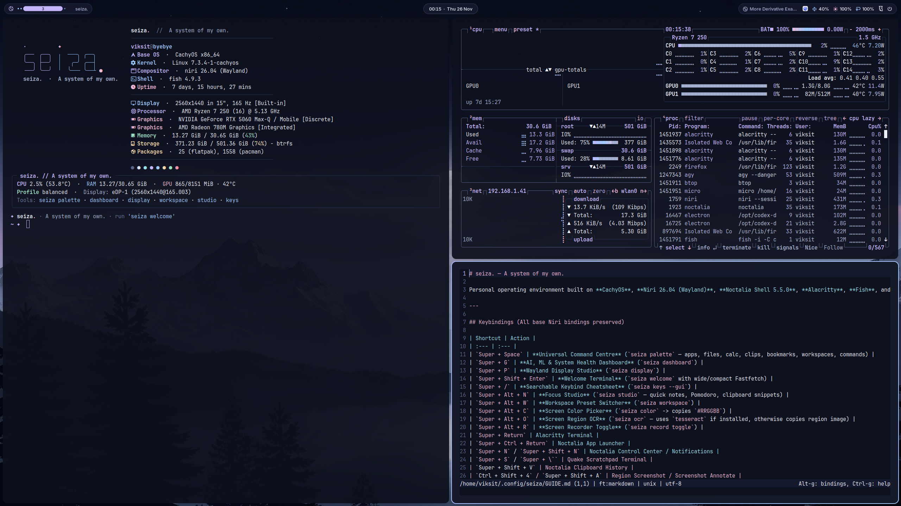
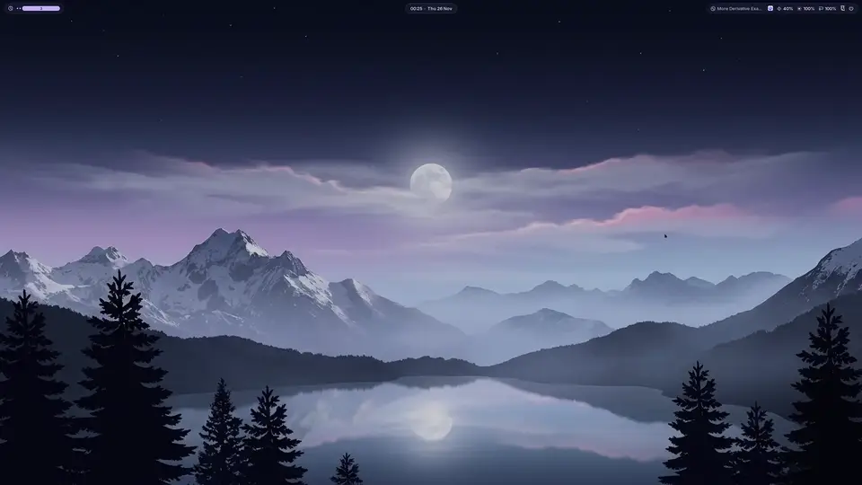
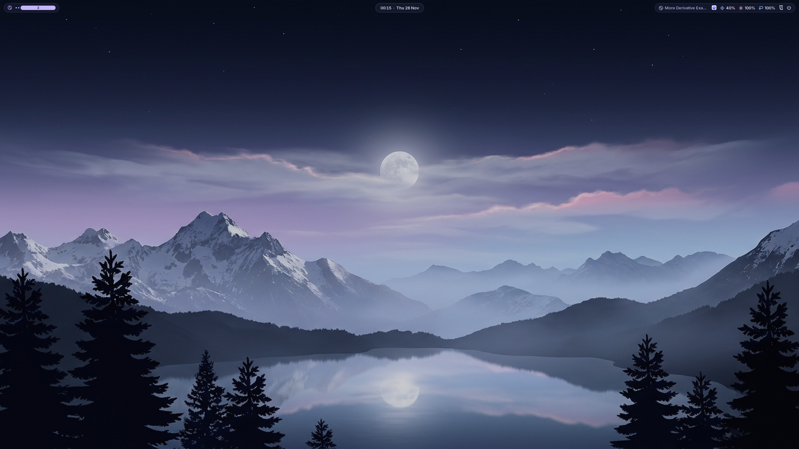
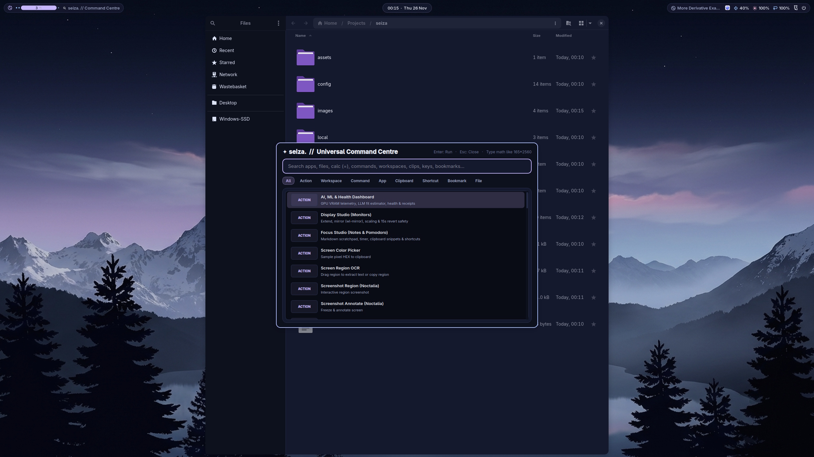
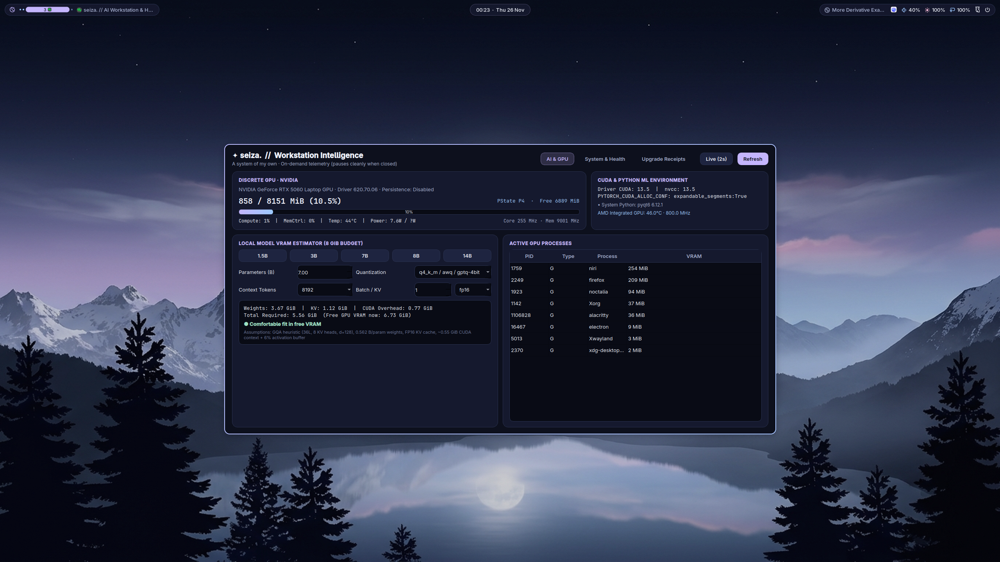
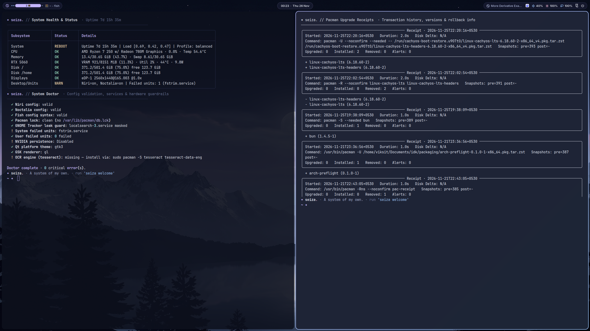
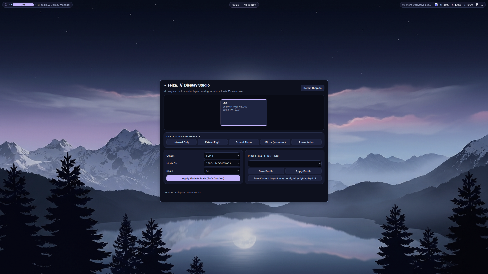
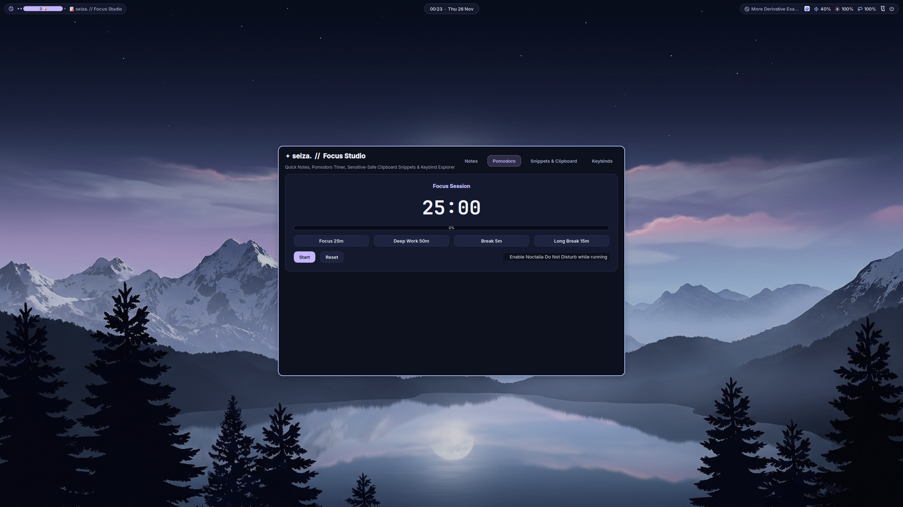
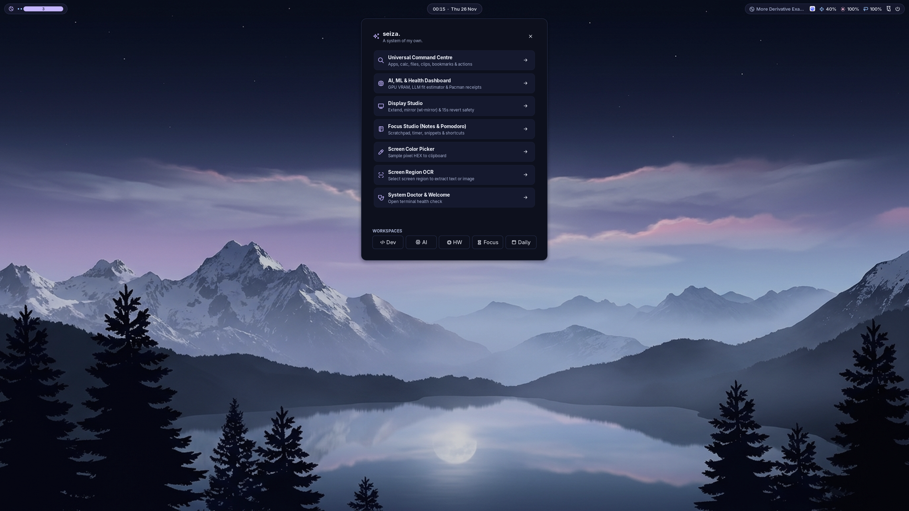

# `seiza.` — *A system of my own.*

A minimalist, cohesive **CachyOS + Niri (Wayland) + Noctalia Shell** desktop environment and personal workstation toolkit. Midnight obsidian surfaces, restrained pastel lavender & celestial accents, fluid springs, crisp window framing, and an integrated PyQt6/CLI developer & AI workstation suite.



---

## Live 30s Walkthrough



> **Full 30-second 1080p @ 60fps MP4 recording:** [`images/seiza-demo.mp4`](images/seiza-demo.mp4)

---

## Showcase & Features Gallery

| Clean Moonlit Desktop & 3-Island Bar | Universal Command Centre & GTK4 Files |
| :---: | :---: |
|  |  |

| AI, ML & Workstation Intelligence (`Super + G`) | System Health, Doctor & Pacman Receipts |
| :---: | :---: |
|  |  |

| Wayland Display Studio (`Super + P`) | Focus Studio (Pomodoro, Notes, Snippets) |
| :---: | :---: |
|  |  |

<details>
<summary><b>Native Noctalia Hub & Workspace Switcher (click to expand)</b></summary>



</details>

---

## Visual Identity & Stack

- **Compositor:** `niri` (Wayland) with custom springs, gradient focus ring (`#C4B5FD` -> `#9CC9FF`), scratchpad console, and floating rules for utility overlays.
- **Desktop Shell:** `noctalia` (three-island top bar, frosted-free crisp panels, Control Center shortcuts, lockscreen, region screenshot & annotation, clipboard history, native `seiza.` hub plugin).
- **Terminal & Prompt:** `alacritty` + `fish` + lean `starship` (`<2ms` in `$HOME`, project-scoped Python detection, exit status & duration badges, zero expensive per-prompt hardware polling) + `fastfetch` wide & compact modes.
- **Unified App Palette:** GTK 3/4 (`adw-gtk3-dark` overrides), Qt (`gtk3` platform theme), Fuzzel, Micro editor, Zathura, CAVA, and `theme-sync`.

---

## One-Command Transform (`run.sh`)

Transform any fresh or existing **CachyOS** (or Arch Linux) setup safely in one command:

```bash
curl -fsSL https://raw.githubusercontent.com/VIKSIT-GARG/seiza/main/run.sh | bash
```

Or clone and inspect first (recommended):

```bash
git clone https://github.com/VIKSIT-GARG/seiza.git
cd seiza
./run.sh
```

Useful installer options:

```bash
./run.sh --dry-run          # Preview everything without modifying packages or files
./run.sh --skip-packages    # Deploy dotfiles, wallpapers, CLI & GUIs without running pacman
./run.sh --with-browser     # Install Firefox if no Wayland browser is present
./run.sh --set-shell        # Set fish as default login shell
./run.sh --restore          # Restore your pre-seiza backup snapshot cleanly
```

Every run automatically snapshots overwritten configs to `~/.config/rice_backups/pre_seiza_install_<timestamp>/` alongside an executable `rollback.sh`.

---

## Workstation Toolkit (`seiza`)

| Command | Purpose |
| :--- | :--- |
| `seiza welcome` | Adaptive wide/compact Fastfetch & live workstation overview |
| `seiza status [--json]` | CPU, thermals, RAM/zram, GPU, storage, displays & failed units |
| `seiza gpu [--watch\|--gui\|--estimate 7]` | Live NVIDIA/AMD telemetry, CUDA check, active GPU processes & 8 GiB VRAM LLM fit estimator |
| `seiza dashboard` | Launch the PyQt6 **AI, ML & System Health Dashboard** (on-demand polling only while open) |
| `seiza display [list\|internal\|extend\|mirror\|present]` | Wayland/Niri multi-monitor manager with `wl-mirror` & **15s auto-revert safety dialog** |
| `seiza workspace [preset\|--list]` | Launch curated environments (`development`, `ai-research`, `electronics`, `focus`, `everyday`) |
| `seiza palette` | **Universal Command Centre** — apps, inline math, workspaces, commands, clipboard, keybinds, bookmarks & files |
| `seiza studio` / `notes` / `pomodoro` | **Focus Studio** — Markdown scratchpad, Pomodoro timer with DND toggle & sensitive-safe pinned snippets |
| `seiza update [--check\|--receipts\|--last]` | Safe full upgrades with Pacman upgrade receipts & rollback snapshot tracking |
| `seiza clean [--dry-run]` | Preview & selectively clean caches, orphans & journal |
| `seiza doctor` / `network` | Diagnostics for compositor/shell configs, systemd units, NVIDIA persistence, Wi-Fi/DNS/ports |
| `seiza color` / `ocr` / `record` | Pixel color picker (`grim`), region OCR (`tesseract`), and screen recording toggle |
| `seiza keys [query\|--gui]` | Searchable shortcut reference parsed live from `~/.config/niri/cfg/keybinds.kdl` |

---

## Keybindings

| Chord | Action |
| :--- | :--- |
| `Super + Space` | Universal Command Centre (`seiza palette`) |
| `Super + G` | AI, ML & Health Dashboard (`seiza dashboard`) |
| `Super + P` | Display Studio (`seiza display`) |
| `Super + Shift + Enter` | Welcome Terminal (`seiza welcome`) |
| `Super + /` | Searchable Keybind Cheatsheet (`seiza keys --gui`) |
| `Super + Alt + N` | Focus Studio (`Notes`, `Pomodoro`, `Snippets`) |
| `Super + Alt + W` | Workspace Preset Switcher |
| `Super + Alt + C` | Screen Color Picker |
| `Super + Alt + O` | Screen Region OCR |
| `Super + Alt + R` | Screen Recording Toggle |
| `Super + Return` | Alacritty Terminal |
| `Super + Ctrl + Return` | Noctalia App Launcher |
| `Super + S` / `Super + \`` | Quake Scratchpad Console |
| `Super + N` / `Super + Shift + N` | Noctalia Control Center / Notifications |
| `Super + Shift + V` | Noctalia Clipboard History |
| `Ctrl + Shift + 4` / `Super + Shift + A` | Region Screenshot / Annotate |
